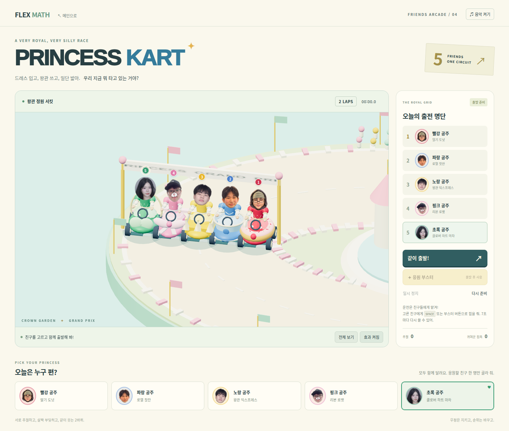
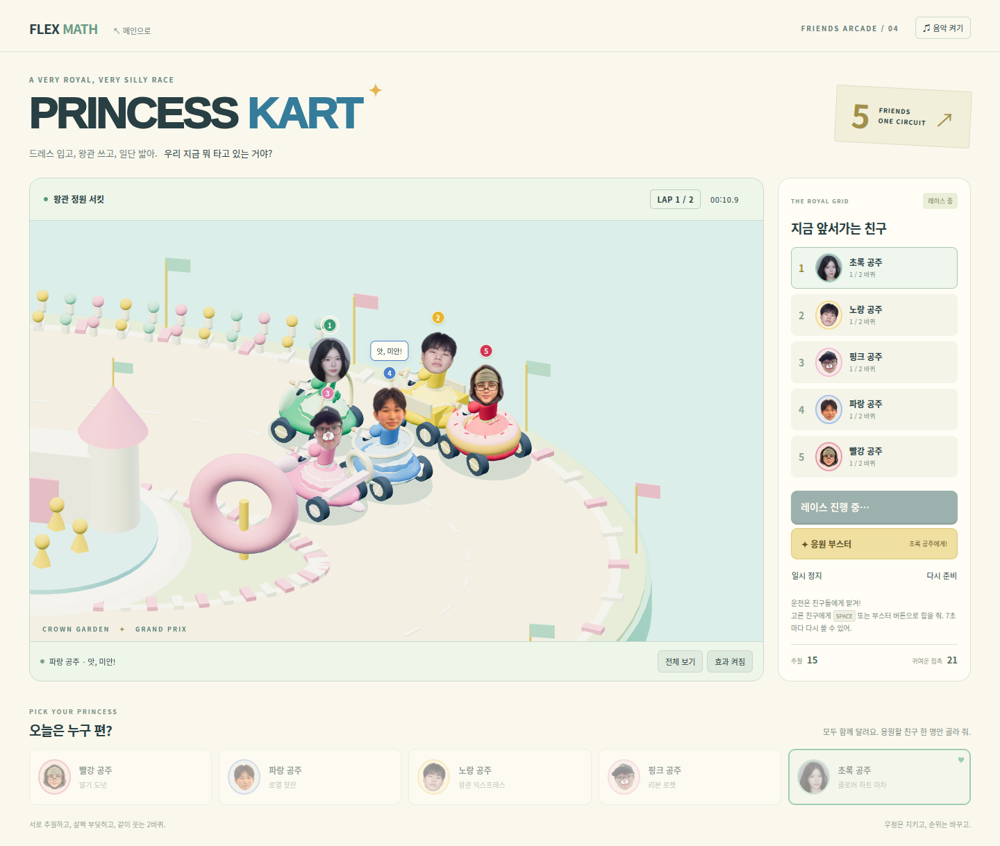
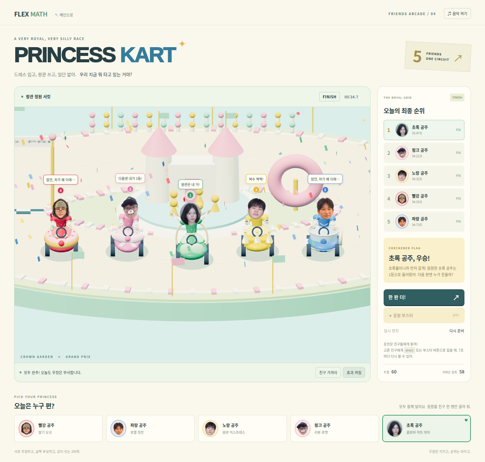

# PRINCESS KART — five friends, one circuit

Independent, buildless arcade mode at `kart/index.html`. **Review branch only:
do not merge or deploy until the owner approves.** Based on main
`3d83a0a99c258ba2881944c6182b59eb332d5a3a`, which already contains the princess
rig, SPECIAL ROUND and BONUS ROUND.

## Play

Pick a friend, press **같이 출발!**, and watch all five race two laps. Steering
and accelerating are automatic. The **응원 부스터** button (or Space when a
button/link is not focused) boosts the chosen friend; recharge takes 7 seconds.
AI racers also have bursts of speed. The winner is decided by crossing time,
not by the selected character or a scripted result. A round takes about
40 seconds including the countdown.

Use **친구 가까이** to follow the whole pack, **전체 보기** for the whole
circuit, and **일시 정지** / **다시 준비** as needed. Mobile starts in pack view
and shows a fixed boost/pause bar while racing. Music is opt-in; the
existing original BONUS beat is reused read-only. Reduced motion disables
extra wobble, cloth flutter, confetti and cheer hops, while the essential
race movement remains. This is a local five-character AI mini-game, not
networked multiplayer.

## Files and extension points

| File | Responsibility |
| --- | --- |
| `racers.js` | Names, exact original face paths, colours, vehicle types, optional face display window and palette |
| `race.js` | Pure seeded fixed-step simulation; shared collisions, passing, boost, pause/reset, lap and crossing-time results |
| `driver.js` | Seated pose adapter for the unchanged shared princess rig; green palette is instance-local |
| `vehicles.js` | Original procedural donut, tea cup, crown, ribbon and heart carriage geometry |
| `scene.js` | Track, five rigs, original-photo display, overview/follow cameras, reaction bubbles and finish tableau |
| `controller.js` | Mode-local state and accessible controls; never imports main gameplay state |
| `index.html`, `kart.css` | Responsive isolated mode UI |
| `kart.test.js`, `baseline.json` | Simulation, contact/finish, rig/photo and old-runtime preservation checks |
| `browser-smoke.mjs` | Chrome/WebGL desktop, mobile, countdown/race/results and screenshot checks |

To add a friend, add an object to `RACERS` with a unique `id`, `name`, `face`,
`profile` (`hood`, `smile`, `cat`, or `cap`), colour fields, and an existing
`vehicle` type. An optional `palette` gives that instance its own dress colours.
Add a new factory branch in `vehicles.js` for a completely new kart shape.
Grid size, UI, collisions, standings and finish logic derive from the array.
Four-, five- and six-racer configurations are covered by the simulation tests.

## Face preservation

The four existing PNGs are referenced directly and remain byte-identical.
`assets/green-face.png` is the complete uploaded **976 × 1433** PNG, also
byte-identical (Git blob SHA `9466d967b982d4c7208f99db001cc0276fac9c13`).
Its face window is display-only: the runtime clips the existing image pixels
to an oval and the selection card uses a CSS viewport. No generated facial
pixels, retouching, replacement expression or synthesized side/back is used.
All five camera-facing portraits remain children of the head in the shared
rig hierarchy. The intentional 2.5D photo convention preserves identity
through turns. The new friend is added to this new mode only; the existing
four-character main-game selector is unchanged.

## Isolation and validation

Only one exact link is added to the original lobby. Existing main-game,
SPECIAL and BONUS runtime files, styles, shared rig/dresses and original
photos are checked against their Git blob hashes. Two earlier lobby tests
are extended to strip that exact new link before checking their original
hashes; their protection is retained. CI is extended with the kart suite and
screenshots, without any deployment step or new push trigger.

Local checks:

```sh
npm test
node --test bonus/bonus.test.js kart/kart.test.js
```

The existing GitHub Actions workflow runs real Chrome with software WebGL,
the new kart browser smoke test, and all existing main/SPECIAL/BONUS browser
tests. Screenshots are uploaded as `game-test-screenshots` / `kart-previews`.
The kart test pauses virtual time and advances the actual simulation in
bounded steps for deterministic, efficient GPU captures. A separate mobile
browser uses real time, unmodified WebGL and reduced-motion settings.

Original faces are intentionally billboard photos. This mode does not try
to create a photorealistic 3D head, complex cloth physics, manual driving or
online multiplayer. It prioritizes a stable shared track and funny reactions.

## Verified review — 2026-10-15

Runtime commit: `65be4b50c49cb2a5de8b5919d1a8c36a0e34758c`.
[Successful complete workflow](https://github.com/hodo-12/flex-math/actions/runs/38731937244).

- 49 distinct automated checks passed (31 main/rig/SPECIAL + 7 BONUS + 11 KART;
  the existing workflow additionally repeats the 9 shared-rig checks).
- KART Chrome/WebGL: five loaded original photos, countdown and simultaneous
  driving, boost/cooldown, overtaking, reciprocal contacts, all five finishers,
  winner/loser tableau, pause, interrupted reset, selection and opt-in music.
- Separate real-time 390px mobile session: reduced motion, no horizontal
  overflow, whole-pack close view, visible fixed boost/pause controls.
- BONUS and SPECIAL: correct wins, wrong losses, four rounds, animation
  progression, input locks, reset, reduced motion, mobile and lobby return.
- Main game: level 3 wrong answer, three correct choices, completion, existing
  level entry, atlas and quiz. Existing runtime/face hash baselines also passed.

The images below are actual Chrome captures from that verified commit. The
follow-up commit adds only these captures and this review record; no runtime
code changes. The PR remains open and unmerged. No Pages deployment was made.

### Five friends including the new green princess



### Shared race and contact reaction



[Whole-circuit race view](previews/racing.png)

### Finish and reactions



[Mobile view with all five faces](previews/mobile-grid.png)
